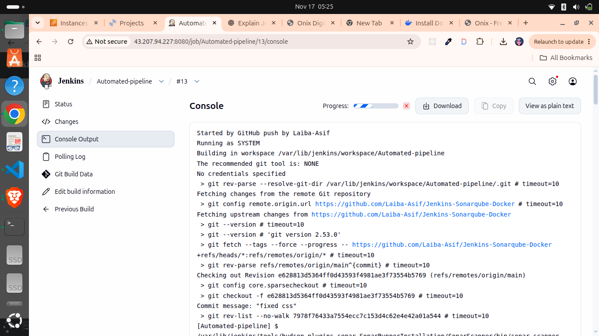
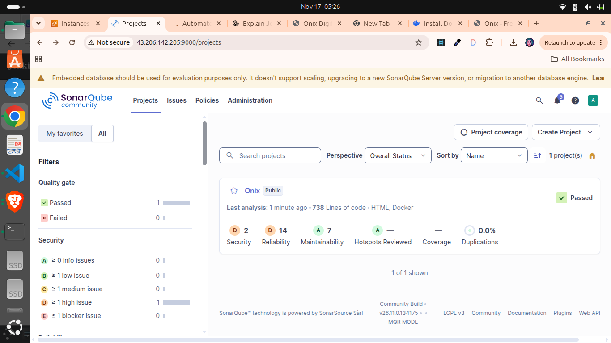
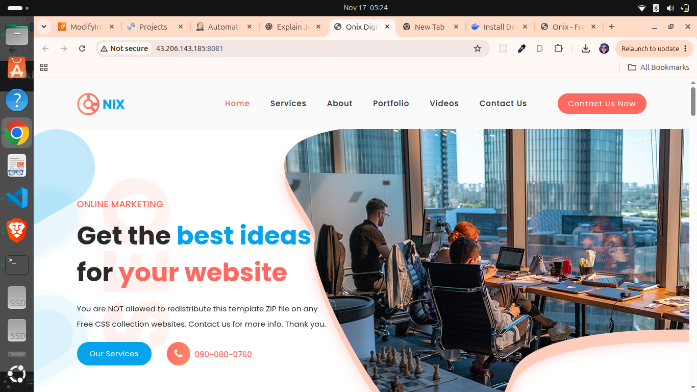

# 🚀 End-to-End CI/CD Pipeline using Jenkins, GitHub, SonarQube, Docker & AWS EC2


## 📌 Project Overview

This project demonstrates the implementation of an end-to-end Continuous Integration and Continuous Deployment (CI/CD) pipeline using **Jenkins, GitHub, SonarQube, Docker, and AWS EC2**.

The objective was to automate the application deployment process, integrate static code analysis, and deploy a web application to a remote AWS EC2 instance using Docker.

Jenkins acts as the central automation server, retrieving source code from GitHub, triggering SonarQube analysis, transferring application files to a remote Docker server through SSH/SCP, building a Docker image, and deploying the application inside a container.

The frontend application is built using HTML5, CSS3, Bootstrap, JavaScript, and jQuery and is served through Nginx.

## 🏗️ Architecture & Workflow

The project uses three separate AWS EC2 instances:

- **EC2 Instance 1 – Jenkins Server:** Runs Jenkins and orchestrates the CI/CD pipeline.
- **EC2 Instance 2 – SonarQube Server:** Performs static code analysis.
- **EC2 Instance 3 – Docker Server:** Receives application files, builds Docker images, and runs the application container.

### CI/CD Pipeline Flow

```text
                  Developer
                      |
                      v
               GitHub Repository
                      |
                      v
              Jenkins EC2 Instance
                      |
                      v
               Source Code Checkout
                      |
                      v
                SonarQube Analysis
                      |
                      v
               SSH / SCP Connection
                      |
                      v
               Docker EC2 Instance
                      |
                      v
                Copy Application Files
                      |
                      v
                 Docker Image Build
                      |
                      v
              Run Docker Container
                      |
                      v
                 Nginx Web Server
                      |
                      v
                Live Web Application
```

## 🛠️ Technologies & Tools

| Technology | Purpose |
|---|---|
| AWS EC2 | Hosting Jenkins, SonarQube, and Docker |
| Ubuntu Linux | Operating system for EC2 instances |
| Jenkins | CI/CD pipeline automation |
| GitHub | Source code management and version control |
| SonarQube | Static code analysis |
| SonarScanner | Sending project analysis to SonarQube |
| Docker | Application containerization |
| Nginx | Hosting the static web application |
| SSH | Secure communication with the remote server |
| SCP | Secure application file transfer |
| HTML5 & CSS3 | Frontend development |
| Bootstrap | Responsive frontend styling |
| JavaScript & jQuery | Frontend functionality |

## ⚙️ Implementation Steps

### 1. AWS Infrastructure Setup

Provisioned three separate Ubuntu EC2 instances to host the project components.

- Configured the Jenkins server.
- Set up a dedicated SonarQube server.
- Prepared a separate Docker deployment server.
- Configured the necessary network access and security group rules for communication between the instances.

### 2. GitHub Integration

- Created a GitHub repository containing the website source code.
- Configured Jenkins to retrieve the application code from GitHub.
- Used GitHub as the source of truth for application updates.

### 3. Jenkins Configuration

Installed and configured Jenkins on AWS EC2.

Configured a Jenkins job to automate the CI/CD workflow, including:

- Retrieving source code from GitHub.
- Executing SonarQube analysis.
- Transferring application files to the Docker server.
- Building and deploying the Docker container remotely.

### 4. SonarQube Integration

Deployed SonarQube on a separate AWS EC2 instance and integrated it with Jenkins.

Implementation included:

- Creating a SonarQube project.
- Generating an authentication token.
- Configuring Jenkins credentials for secure authentication.
- Configuring SonarScanner for project analysis.
- Successfully executing code analysis and uploading the report to SonarQube.

### 5. SSH & SCP Configuration

Established secure, key-based SSH authentication between the Jenkins server and the Docker deployment server.

Configured Jenkins to:

- Connect to the remote EC2 instance using SSH keys.
- Create the application deployment directory.
- Transfer project files using SCP.
- Execute remote Docker commands over SSH.

The application files are transferred to:

```text
/home/ubuntu/website
```

This eliminates the need for manual file transfers during deployment.

### 6. Docker Image Creation

Created a Dockerfile using the official Nginx image:

```dockerfile
FROM nginx
COPY . /usr/share/nginx/html/
```

**How it works:**

- Uses the official Nginx image as the base image.
- Copies the website source files into Nginx's default HTML directory.
- Serves the static frontend application through Nginx.

### 7. Docker Deployment through Jenkins

Configured Jenkins to remotely execute Docker commands on the Docker EC2 instance.

The deployment process includes:

1. Creating the website directory if it does not already exist.
2. Copying the latest application files using SCP.
3. Building the Docker image on the remote server.
4. Removing the previous application container if it exists.
5. Starting a new container with the updated image.

Docker image:

```bash
docker build -t onix-website .
```

Remove the previous container:

```bash
docker rm -f onix-website-container || true
```

Run the new container:

```bash
docker run -d \
  --name onix-website-container \
  -p 8081:80 \
  onix-website
```

The application is served on port `8081` of the Docker EC2 instance.

## 📸 Project Screenshots

### 1. Jenkins Dashboard

Jenkins server configured to manage and execute the CI/CD workflow.


### 2. Jenkins Build Execution

Jenkins build execution showing the automated pipeline activities, including source code checkout and SonarQube analysis.



### 3. SonarQube Analysis Dashboard

Successful SonarQube analysis of the Onix Digital website project.



### 4. Final Application Deployment

The frontend website successfully deployed and accessible through the Docker container running on AWS EC2.



## 🔒 Security & Configuration

Security considerations implemented during this project:

- Used SSH key-based authentication instead of password-based remote login.
- Configured Jenkins to use a dedicated SSH deployment key.
- Stored the SonarQube authentication token in Jenkins credentials.
- Used AWS security groups to control network access.
- Avoided placing private keys and authentication tokens in the GitHub repository.

## 🎯 Key Learnings & Skills Gained

This project provided practical experience in:

- AWS EC2 provisioning and Linux server administration.
- Jenkins installation and CI/CD automation.
- GitHub and Jenkins integration.
- SonarQube configuration and static code analysis.
- Secure SSH key-based authentication.
- Remote file transfer using SCP.
- Dockerfile creation and Docker image building.
- Running and managing Docker containers.
- Deploying applications on remote AWS EC2 instances.
- Troubleshooting real-world deployment and connectivity issues.

## 🚀 Future Enhancements

Potential improvements to this project include:

- Implementing a declarative Jenkinsfile for pipeline-as-code.
- Adding automated application testing.
- Integrating SonarQube Quality Gate checks.
- Scanning Docker images for vulnerabilities using Trivy.
- Pushing Docker images to Amazon Elastic Container Registry (ECR).
- Implementing automated rollback for failed deployments.
- Integrating AWS IAM roles and OIDC for improved credential management.

## 👩‍💻 Author

**Laiba Asif**

Software Engineering Graduate | Aspiring DevOps Engineer

GitHub: [Laiba-Asif](https://github.com/Laiba-Asif)

---

⭐ If you find this project useful, feel free to explore the repository and share your feedback!